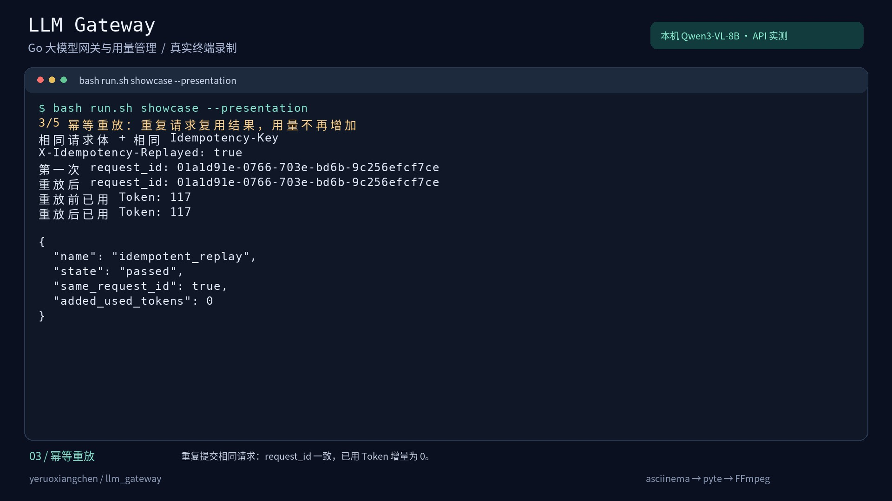
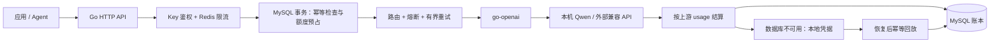

# LLM Gateway：大模型网关与用量管理

独立的 Go 后端项目。应用通过统一的 OpenAI Chat API 调用模型，网关负责 API Key、模型路由、限流、额度预占、用量结算、故障恢复和审计查询。本机演示复用已经运行的 Qwen3-VL-8B，不另起模型任务。

源码位于 `internship_project_lab/llm_gateway`，数据库、依赖、构建缓存和测试产物位于 `/data/zjr/llm_gateway`。服务使用独立端口、数据库、密码和 `llmgw-*` 用户服务。

## 演示视频

[](https://github.com/yeruoxiangchen/llm_gateway/raw/refs/heads/main/docs/media/llm-gateway-demo.mp4)

[观看 / 下载 MP4](https://github.com/yeruoxiangchen/llm_gateway/raw/refs/heads/main/docs/media/llm-gateway-demo.mp4)：约 70 秒，1920×1080，中文说明，无旁白。录制于 2026-11-14，真实调用本机 Qwen3-VL-8B；普通响应、SSE、幂等、额度和 Key 撤销五步全部通过。本轮消耗 117 Token，重放增量为 0。

视频使用实际终端事件与原始输出时间，结尾停留 12 秒展示结果。可下载 [原始 asciinema 记录](docs/media/llm-gateway-demo.cast)，或查看 [章节与编码信息](docs/media/llm-gateway-demo.json)。重新录制的方法见 [录制说明](docs/recording.md)。

## 成熟组件如何复用

| 工作 / 组件 | 本项目的使用方式 |
| --- | --- |
| [New API](https://github.com/QuantumNous/new-api) | 网关产品能力、模型映射及用量管理的设计参考。账户事务、租约和故障验收是本项目实现。 |
| [go-openai](https://github.com/sashabaranov/go-openai) | 实际使用其 Chat、工具调用和 SSE 客户端；上游协议解析交给 SDK。 |
| [go-sql-driver/mysql](https://github.com/go-sql-driver/mysql) + MariaDB | 实际使用连接池、InnoDB 事务、行锁和唯一约束保存账本。SQL 兼容 MySQL，本机验收使用 MariaDB。 |
| [go-redis](https://github.com/redis/go-redis) | 实际使用 Redis 客户端，Lua + Redis TIME 原子执行跨实例 RPM 限流。 |
| [gobreaker](https://github.com/sony/gobreaker) | 实际使用连续失败熔断及半开探测。 |
| [Prometheus Go client](https://github.com/prometheus/client_golang) | 实际暴露请求、延迟、首事件耗时、并发和结算补偿指标。 |

Go 工具链版本和依赖版本分别固定在本机安装记录与 `go.mod/go.sum` 中。本机工具链为 Go 1.27.4。

## 主要功能

- 账户、Token 总额度、API Key 签发和吊销，Key 独立 RPM；用户密钥存 SHA-256 摘要，上游密钥使用 AES-GCM 加密。
  RPM 使用 Redis 时间的固定自然分钟窗口。
- 模型别名、优先级路由、同优先级轮询、渠道停用；最多尝试两个渠道，首个流式事件发出后保持同一条生成链路。
- 文本 / 工具调用的 OpenAI Chat JSON 和 SSE 接口，输出 Token 上限 1–4096，单请求体 64 KiB，响应及回放缓存上限 4 MiB。
- 账户级额度预占和实际用量结算。预占使用请求字节数加余量和输出上限估算，实际结算采用上游 `usage`。实际用量超过估算时记录真实消耗，负余额阻止后续请求。
- `Idempotency-Key` 在账户内唯一，按字节区分大小写。相同内容的并发请求只派发一次；完成后回放原响应；不同内容返回 409。
- 响应缺失用量或流式中断时进入 `pending_usage`，保留预占，由管理员依据实际凭据补录用量或退款，并保存理由。
- 数据库中断后的本地结算凭据、原子落盘、恢复回放；进程失联后的实例租约恢复；用量汇总和逐请求审计。



## 本机使用

当前服务器已有网关、数据库、Redis 和本机 Qwen。先检查状态，再运行一键演示：

```bash
cd /home/zjr/Tracker/internship_project_lab/llm_gateway
bash run.sh status
bash run.sh showcase
```

`showcase` 依次展示普通回答、SSE 流式回答、幂等重放不重复记账、额度耗尽返回 402、Key 吊销后返回 401。每轮使用独立账户及渠道，结束后停用演示 Key 与渠道，保留账本。只产生两次模型生成，默认复用本机 Qwen。报告保存在 `/data/zjr/llm_gateway/checks/showcase/`。

单独体验普通 / 流式调用和用量查询：

```bash
cd /home/zjr/Tracker/internship_project_lab/llm_gateway
bash run.sh status
bash run.sh start
bash run.sh demo --prompt '12加8减5等于多少？只回答数字。'
bash run.sh demo --stream --prompt '用两句话解释 API 网关的作用。'
bash run.sh demo --usage
```

手动演示幂等：连续执行下面同一条命令两次。第一次正常生成，第二次的 `request_id` 相同、`replayed=true`，用量不再增加。每次新演示可以换一个 Key 字符串；重放时保持请求参数一致。

```bash
bash run.sh demo --prompt '12加8减5等于多少？只回答数字。' --max-tokens 32 --idempotency-key presentation-example-1
bash run.sh demo --prompt '12加8减5等于多少？只回答数字。' --max-tokens 32 --idempotency-key presentation-example-1
bash run.sh demo --usage
```

第一次 `demo` 会创建演示账户、Key 和 `local-qwen` 模型别名，连接 `http://127.0.0.1:28282/v1` 的现有模型。客户端配置保存于 `/data/zjr/llm_gateway/config/demo-client.json`，权限为 0600。应用读取其中的 `base_url`、`api_key`、`model` 即可接入。管理凭据保存在同目录的 `gateway.env`。

主 API：`http://127.0.0.1:29480`。仅后端服务，API 可以通过 Postman、HTTP 客户端或现有应用使用。

Windows 连接远程服务器时，在本机 PowerShell 新开终端保持 SSH 端口转发：

```powershell
ssh -N -L 29480:127.0.0.1:29480 zjr@<服务器地址>
```

随后可在本机浏览器打开 `http://127.0.0.1:29480/health/ready` 查看就绪 JSON，或在 Postman 使用该地址及自己的账户 Key 调用 API。完整五步演示仍可在 VS Code 的远程终端执行 `bash run.sh showcase`。

首次准备环境 / 重新构建：

```bash
bash run.sh setup
bash run.sh build
bash run.sh init
bash run.sh start
```

`setup` 把本机缓存的 MariaDB/Redis 可执行程序复制到本项目工具链目录；数据库配置及数据完全独立。更换机器时可自行提供 Go、MySQL 和 Redis，然后设置 `internal/gateway/config.go` 中的环境变量运行 `cmd/gateway`。

### 在其他机器运行 Go 服务

环境要求：Go 1.26 或以上、一个已创建的 MySQL / MariaDB 数据库和 Redis。可使用 [配置示例](config/gateway.env.example)，将填写后的配置保存到数据目录中，例如 `/data/zjr/llm_gateway_demo/config/gateway.env`。本机现有服务继续使用原数据目录；新环境使用独立目录。

数据库配置中的用户需有目标数据库的建表及读写权限。`LLMGW_ADMIN_TOKEN` 使用至少 24 字符的随机值，`LLMGW_MASTER_KEY` 为 32 字节随机密钥的无填充 base64url 编码。可在自己的终端生成：

```bash
python3 - <<'PY'
import base64, secrets
print('LLMGW_ADMIN_TOKEN=' + secrets.token_urlsafe(32))
print('LLMGW_MASTER_KEY=' + base64.urlsafe_b64encode(secrets.token_bytes(32)).decode().rstrip('='))
PY
```

从独立仓库构建并启动：

```bash
git clone https://github.com/yeruoxiangchen/llm_gateway.git
cd llm_gateway
set -a
source /data/zjr/llm_gateway_demo/config/gateway.env
set +a
export TMPDIR="$LLMGW_DATA_ROOT/tmp"
export GOCACHE="$LLMGW_DATA_ROOT/cache/go-build"
export GOMODCACHE="$LLMGW_DATA_ROOT/cache/go-mod"
mkdir -p "$TMPDIR" "$GOCACHE" "$GOMODCACHE" "$LLMGW_DATA_ROOT/bin"
go build -trimpath -o "$LLMGW_DATA_ROOT/bin/gateway" ./cmd/gateway
"$LLMGW_DATA_ROOT/bin/gateway"
```

数据库和 Redis 由该机器自行管理；Go 服务在已有数据库中初始化表结构。需要演示模型调用时，配置中的 `LLMGW_MODEL_BASE_URL`、`LLMGW_MODEL_NAME`、`LLMGW_MODEL_API_KEY` 指向自己的兼容 Chat API。Linux 环境下，网关启动后可另开终端加载同一配置，使用 Python 3.10+ 执行 `python3 -B scripts/showcase.py`。本机的 `run.sh`、故障及压测脚本使用现有服务器的工具链路径和用户服务；独立运行 Go 服务使用上面的环境变量方式。

### 五分钟演示顺序

1. 展示 `GET /health/ready` 和项目架构图，说明应用、网关、模型及存储的关系。
2. 运行 `bash run.sh showcase`，观察普通回答和流式输出。
3. 展示相同请求 ID 的重放，以及 `added_used_tokens=0`。
4. 展示额度不足的 402 和 Key 吊销后的 401；解释两个拒绝均发生在模型调用前。
5. 打开 [验收记录](docs/validation.md)、[公开数据与负载记录](docs/public-qa.md) 和 [可公开数值摘要](docs/reports/2026-11-14-summary.json)，说明测试规模、模型得分与网关能力的区别。

停止本项目全部服务：

```bash
bash run.sh stop
```

## API

普通接口使用账户 Key，管理接口和 `/metrics` 使用管理员 Bearer Token。

| 方法与路径 | 用途 |
| --- | --- |
| `GET /health/live`、`GET /health/ready` | 进程存活、数据库与 Redis 就绪状态 |
| `GET /v1/models` | 可用模型别名 |
| `POST /v1/chat/completions` | 普通响应、SSE、工具调用 |
| `GET /v1/usage` | 当前账户额度、已用量、预占、最近 100 条请求 |
| `GET /v1/requests/{id}` | 当前账户的请求和结算状态 |
| `POST /admin/accounts` | 创建账户：`name`、`quota_tokens` |
| `PUT /admin/accounts/{id}/quota` | 调整总额度；额度应覆盖已用和预占 |
| `POST /admin/accounts/{id}/keys` | 签发 Key：`name`、`requests_per_minute`；明文仅在签发响应返回 |
| `DELETE /admin/keys/{id}` | 吊销 Key |
| `POST /admin/providers` | 注册上游、别名和单价，字段见下例 |
| `GET /admin/providers` | 查询渠道，响应隐藏密钥 |
| `PATCH /admin/providers/{id}` | `{"enabled": false}` 停用渠道 |
| `GET /admin/requests?account_id=...` | 最近 100 条审计记录 |
| `GET /admin/usage?group_by=model&account_id=...` | 按 `model/account/provider/day` 汇总用量、请求结果、成本 |
| `POST /admin/requests/{id}/resolve` | 处理待结算用量，需提供审计理由 |
| `GET /metrics` | Prometheus 格式指标 |

渠道注册示例 JSON：

```json
{
  "name": "local-qwen",
  "model_alias": "local-qwen",
  "upstream_model": "office-qwen3-vl-8b",
  "base_url": "http://127.0.0.1:28282/v1",
  "api_key": "local-reuse",
  "enabled": true,
  "priority": 10,
  "input_micro_usd_per_million_tokens": 0,
  "output_micro_usd_per_million_tokens": 0
}
```

成本以整数微美元保存，单价字段为“每百万 Token 的微美元价格”；默认本地模型价格为 0。这里管理 Token 额度和估算成本，实际支付账单应与服务商凭据核对。

汇总接口默认最近 24 小时，支持 RFC3339 的 `since`、`until`，每次最多查询 31 天、返回 1000 组。Token 用量只汇总已经取得有效 `usage` 的记录，未知用量单独计入 `pending_usage`。

处理待结算请求：

```json
{"usage":{"prompt_tokens":20,"completion_tokens":10,"total_tokens":30},"reason":"依据上游请求回执核对"}
```

或：

```json
{"refund":true,"reason":"核对上游未产生计费用量，释放预占"}
```

## 一致性与恢复

`accounts` 保存账户计数，`requests` 保存请求状态与响应回放，`ledger` 保存每次预占 / 结算的增量，`attempts` 保存渠道尝试。预占和结算都先锁账户，再锁请求；唯一约束限制一次请求的预占及结算事件各只有一条。

实例心跳独立保存在 `owner_leases`。它避免心跳批量更新请求表与结算修改状态索引之间的锁顺序冲突。恢复时重新锁定并检查租约：未派发请求释放额度，已派发且用量未知的请求保留预占并标记待核对。

数据库不可用时，已知用量写入 `/data/zjr/llm_gateway/spool`；文件采用 0600 权限、临时文件、`fsync` 和重命名。恢复后按请求 ID 回放，同一回执重复执行保持相同账本结果。磁盘写入失败会记录明确错误，需要根据请求 ID 核对上游。

重试仅发生在下游尚未收到响应时，适用于 429、502、503、504。一次超时的上游也可能产生服务商费用，因此跨服务商账单仍须核对；本项目按用户交付结果及获得的用量回执维护内部账本。

## 入口保护与数据库预算

Chat 请求在访问鉴权和渠道数据库前获取全局并发槽位，槽位覆盖鉴权、模型调用和结算。并发满时返回 HTTP 503、`gateway_busy` 及 `Retry-After: 1`；健康检查和管理接口仍可访问。请求总时间预算从入口开始计算。

`LLMGW_DATABASE_READ_TIMEOUT_MS` 默认 1000，限制鉴权和渠道查询（包括连接池等待）。`LLMGW_ADMISSION_TIMEOUT_MS` 默认 5000，向预占 / 首次派发事务传播准入预算，限制连接获取和 SQL / 行锁等待。对应错误为 `authentication_timeout`、`provider_lookup_timeout`、`admission_timeout`。已发出的 COMMIT 仍受驱动读写超时约束，提交确认丢失继续走幂等清理与持久回执，不依据一次超时直接假设回滚成功。

等待模型响应头使用请求总预算，适配生成结束后才发送响应头的普通响应。请求上下文仍限制从入口开始的总时间，流式空闲等待单独受 `LLMGW_STREAM_IDLE_SECONDS` 限制。超过 15 秒的合法生成和短期限取消均有回归覆盖。

`llmgw_protection_rejections_total{reason="..."}` 分别记录拒绝原因。`llmgw_inflight` 覆盖入口后的全部 Chat 处理，`llmgw_request_seconds` 包含鉴权耗时。

`LLMGW_METADATA_DB_CONNECTIONS` 默认 2，从 `LLMGW_DB_CONNECTIONS` 的总额度中划给鉴权和渠道查询；负载实例总额度 16 时为查询 2、事务 14。两组连接指向同一数据库，事务内仍重新检查 Key 状态。设置为 0 可运行共享池对照。`go_sql_*` 的 `db_name=gateway` / `gateway_metadata` 分别报告两组连接池；`metadata_acquire`、`authenticate_query`、`providers_query` 区分获取连接与执行查询。

Redis 限流为每次 HTTP 调用生成内部操作号，同一操作的有限重试读取原结果。计数、窗口和幂等结果由同一次多字段 HSET 保存，保留原有计数键与每分钟语义；结果逻辑保留 120 秒，HSCAN 分批回收过期字段。客户端提供的幂等键用于模型请求，限流操作号由服务器独立生成。

`LLMGW_RATE_LIMIT_TIMEOUT_MS` 默认 3000，至多两次 Redis 脚本尝试，中间退避 25–50 ms；驱动遵守上下文期限，关闭隐式重试。网络断连、短时超时可重试，脚本数据错误直接失败；持续不可用返回 `rate_store_unavailable`。`llmgw_rate_limit_retries_total`、`llmgw_rate_limit_cache_hits_total`、`llmgw_rate_limit_attempts_total` 记录实际尝试及结果复用。数据库刷盘与 Redis AOF 策略保持原值。

真实数据库回归占满连接池并锁住账户行，验证前置拒绝、超时回滚、取消释放，以及恢复后的幂等重试。双实例业务竞争验收使用 128 个入口槽位容纳 100 个并发客户端；独立入口保护测试限制为 2，性能测试仍限制为 32。

`LLMGW_REQUEST_ID_VERSION=4|7` 控制新请求的 UUID，默认 4。版本 7 复用 `google/uuid.NewV7`，以改善 InnoDB 主键插入局部性；旧请求保持原 ID，幂等回放兼容两种版本。实际策略由 `llmgw_request_id_info` 指标记录。隔离测试可使用 `bash run.sh soak --duration 1800 --rps 10 --accounts 4 --concurrency 32 --request-id-version 7`，性能报告保留实际版本及缓冲池物理读取计数。

## 稳定性验收

扩展实验与源码阅读见 [后端深挖与实测记录](docs/deep-dive.md)。新增双实例 100 并发、精确崩溃矩阵、慢客户端、k6 对照、阶段计时和 Go pprof；普通 API 与隔离测试库分别运行。

```bash
# Go race 检测，包含真实 MariaDB 事务、并发结算与租约恢复
bash run.sh test

# 后台执行 21 组真实 HTTP / 故障验收，包含调用既有 Qwen 服务
bash run.sh verify

# 基础负载：模拟协议上游，4 账户，10 RPS，16 并发上限，60 秒
bash run.sh stability --duration 60 --rps 10 --accounts 4 --concurrency 16

# 更高压力场景（会明确记录未达标项）
bash run.sh stability --duration 60 --rps 20 --accounts 4 --concurrency 16

# 扩展实验，各组后台运行，结束后再启动下一组
bash run.sh deepen
bash run.sh install-k6
bash run.sh perf --duration 15
bash run.sh compare --duration 30 --rps 10 --accounts 4 --concurrency 32
bash run.sh soak --duration 1800 --rps 10 --accounts 4 --concurrency 32

# 官方 GSM8K / BoolQ 各抽 20 题，比较真实模型直连、网关 JSON 和 SSE
bash run.sh benchmark --samples 20 --seed 20261113

# 扩大公开题库，并顺序执行原生工具调用及真实模型负载
bash run.sh benchmark --samples 100 --seed 20261114
bash run.sh tools --samples 50 --seed 20261114
bash run.sh real-load --samples 100 --seed 20261114

# 将提交延迟与磁盘、连接池、进程采样按时间关联
bash run.sh diagnose
```

验收涵盖：鉴权 / 吊销 / 租户隔离，普通及流式响应，工具调用，模型路由 / 熔断 / 停用，双实例幂等，并发额度竞争，分布式 RPM，未知用量核对，超估算用量，流式截断 / 超时 / 取消，并发拒绝，Redis 故障，数据库故障后的回执回放，SIGKILL 后租约恢复，真实本机模型结算，最终账本与账户对账。
接口还核对“未知用量保持未知”、普通及 SSE 的补全总 Token 数与账本一致。

负载检查的标准在执行前固定：成功率 100%、P95 <1 秒、P99 <2 秒、账本消耗精确、无预占残留、资源增长有界。k6 的 `perf/soak` 另要求零丢弃迭代；旧 Python 发压工具的吞吐阈值为目标 RPS 的 95%，也会记录未发送负载。`--accounts 1` 可以单独测试热点账户。

自动测试只控制本项目的 `llmgw-*` 服务。故障测试与负载测试互斥，服务默认关闭自动重启。恢复测试中的重新启动是测试步骤。
测试结束后停用当轮渠道并吊销临时 Key，保留审计账本。`bash run.sh report` 可以把最终报告更新到源码中的验收记录。

结果与日志：

```text
/data/zjr/llm_gateway/checks/go-test.json
/data/zjr/llm_gateway/checks/verification.json
/data/zjr/llm_gateway/checks/stability.json
/data/zjr/llm_gateway/checks/stability-<时间>.json
/data/zjr/llm_gateway/logs/{api,peer,verify,stability}.log
```

负载上游是受控 CPU 协议服务，测量的是网关、Redis、MySQL 和账本链路。真实模型验收采用单独的小请求。基础验收见 [验收记录](docs/validation.md)，k6 对照、长测及提交延迟定位见 [深挖记录](docs/deep-dive.md)。

公开题目的真实模型准确率对照见 [GSM8K / BoolQ 评测协议](docs/public-qa.md)。输入与标准答案来自官方数据，固定样本用于比较模型直连、网关普通响应与流式响应；逐题回答和最终对账保存于 `/data/zjr/llm_gateway/checks/benchmark/`。

扩测还使用固定版本的 BFCL 原始题目和官方 AST 评分器，核对工具选择、参数与流式分片；现有模型服务使用 `tool_choice=required`。`real-load` 直接运行已安装的 vLLM 官方负载 CLI，使用固定 BoolQ 原文，覆盖并发 1/4/8、长输入及长输出；数据来源、部署限制和度量口径见同一评测协议。评测相互排斥，调用既有模型服务，报告分别位于 `checks/tools.json` 和 `checks/real-load.json`。

正常请求的事务提交优化见 [准入合并与交替对照](docs/admission-optimization.md)。默认 combined 将额度预占和首次派发放在同一事务，成功路径为两次提交；`LLMGW_ADMISSION_MODE=split` 保留三次提交的对照流程。模型网络调用在事务提交之后执行。

本机正常 API 当前配置为 combined + UUID7。查询连接隔离版本通过 30 分钟网关验收：10 RPS、4 账户、32 VU，18001 次请求全部成功、零丢弃。随后真实 Qwen 扩测完成 1382 次正式调用，涵盖 200 道问答、50 道 BFCL 题及并发、长输入和长输出负载，并修复普通生成的固定 15 秒响应头等待。修复后的 Go race / 真实存储检查 49 项、完整 HTTP 21/21 均通过；固定子集成绩、原轮差异、实测负载和历史失败见 [验收记录](docs/validation.md) 与 [公开数据评测](docs/public-qa.md)。

## 资源及目录

主网关默认 32 并发、120 秒总超时、20 秒 SSE 空闲超时。主网关内存上限 768 MiB，独立数据库 512 MiB、Redis 128 MiB。CPUQuota 配置为 200%；本机用户服务实际只下放 `memory pids` 控制器，CPU 配额和节流数据以宿主机开放情况为准。主网关 Go 调度并行度为 4，k6 为 2。基础故障测试的 peer 实例使用更短的超时和 4 并发，便于验证故障边界。

```text
cmd/gateway/             Go 服务入口
cmd/upstream-fixture/    可控协议 / 故障上游
internal/gateway/       HTTP、路由、限流、SQL 事务、租约、结算
scripts/runtime.py     本机服务编排和资源限制
scripts/acceptance.py  HTTP 与故障验收
scripts/stability.py   负载、资源采样与对账
scripts/performance.py k6 对照、长测与账本核对
scripts/host_monitor.py 每秒进程、磁盘和宿主机采样
scripts/analyze_latency.py 提交延迟时间窗口关联
scripts/demo.py        本地模型调用示例
```

本版使用单个 MySQL 主库、单个 Redis 和本地持久卷。跨机器部署时需要为每个实例提供可恢复的凭据卷，并根据实际流量扩展数据库、Redis 和密钥管理配置。

隔离实例使用 29483 / 29484 和 `llm_gateway_lab`，默认关闭的故障接口仅允许在这些端口启用。诊断实例提供管理员鉴权的 `/debug/pprof/{profile,heap,goroutine,block,mutex,trace}`，CPU/trace 单次采样限制 20 秒。阶段直方图在 `/metrics` 中以 `llmgw_stage_seconds` 暴露，父子阶段可能重叠。

数据库连接池复用官方 `go_sql_*` 指标。`perf/soak` 各组输出 `gateway-samples.jsonl`、`host-samples.jsonl`、`slow-commits.jsonl` 和 `latency-diagnostics.json`；运行时可使用 `bash run.sh diagnose` 查看最新长测的关联窗口。完整采样只在组结束时写入 `measurements.json`，运行中使用 JSONL 增量记录。

`deepen`、`perf`、`soak` 使用 `ExecStopPost` 清理实验进程和凭据，正常、失败及停止退出均执行。单独停止长测：`systemctl --user stop llmgw-soak.service`。其状态和日志为 `/data/zjr/llm_gateway/checks/soak.json` 与 `logs/soak.log`。
